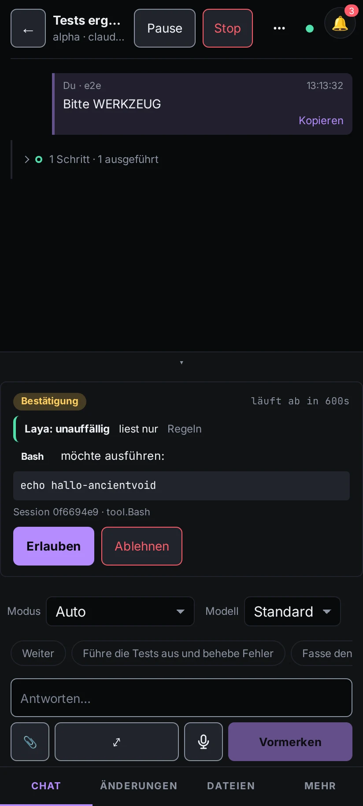
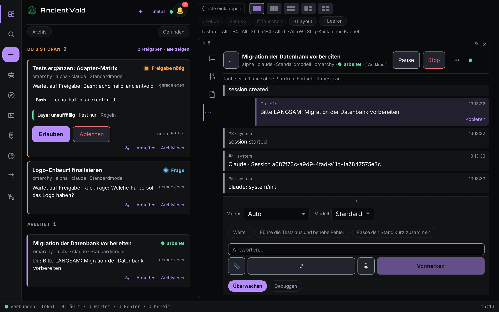

# AncientVoid

[](https://github.com/SiLenTTz/AncientVoid/actions/workflows/ci.yml)

**AncientVoid** is a local-first, vendor-neutral command center for coding
agents: supervise, steer and audit every agent session on all of your own
machines from your phone — over Tailscale, without a public port, without a
cloud service in between.

| Sign-in | Overview (queue) | Approval in a turn | Desktop workspace |
|---|---|---|---|
|  |  |  |  |

Screenshots come from a **demo hub with synthetic stand-ins**
(`scripts/readme-screenshots.mjs`) — no real sessions, no secrets;
reproducible from the repo.

> **Language note:** this README, `CONTRIBUTING.md` and `SECURITY.md` are in
> English. The app UI and most of `docs/`, `epics/` and `bugs/` are currently
> **German** (the project grew as a personal tool; multi-language support is
> planned). Index of all docs pages: [`docs/uebersicht.md`](docs/uebersicht.md).

## What it does

- **One hub per machine** (`apps/hub`) runs your coding-agent CLIs as
  supervised workers (tmux or child processes) and records every session as an
  append-only event log (JSONL + SQLite + blobs).
- **A mobile-first PWA** shows all sessions as a queue: follow a session turn by
  turn, send follow-up prompts, answer agent questions, approve or deny tool
  calls, attach files, pause/resume/stop — from your phone or desktop.
- **Vendor-neutral adapters** for Claude Code, Codex, opencode, GitHub Copilot
  CLI, pi, Hermes, Cursor, aider, any ACP harness and any OpenAI-compatible
  endpoint (llama.cpp, LM Studio, Ollama, vLLM). Read-only observers
  (`claude-clip`, `cursor-clip`) watch sessions you started yourself.
- **Approvals with classes** (`read` free, `write` tap-to-confirm,
  `destructive` WebAuthn/biometric), fail-closed on timeout, fully audited.
- **Multi-host fleet**: several hubs appear in one UI; hand a session over
  between PC and phone.
- **Workspace features**: git worktree per session, diff review, file/project
  explorer, search, slash commands, automations, loops (external "factories"
  observed and steered as sessions), knowledge-vault notes, voice input
  (configurable STT endpoint).
- **Desktop companion** (`apps/companion`, Wayland: Hyprland/sway): types what
  you dictate on the phone into the focused window of your PC —
  [`docs/desktop-companion.md`](docs/desktop-companion.md).
- **Optional MCP gateway sidecar** (`apps/gateway-mcp`, off by default) exposes
  the hub to other agents via three meta-tools.

The full, current feature inventory with E2E evidence lives in
[`docs/funktionsinventar.md`](docs/funktionsinventar.md) (German). The
planning history (PRD, epics P0 … P60) is in [`epics/README.md`](epics/README.md)
(German).

## Platform support

| Platform | Status |
|---|---|
| **Linux** | Primary target. Developed and run daily on Arch Linux (Omarchy); hub as a systemd user service — [`docs/operations-runbook.md`](docs/operations-runbook.md). The desktop companion needs Wayland (Hyprland or sway). |
| **macOS** | Partial / untested. The hub and PWA are plain Node + browser, but some tests and helper scripts assume GNU tools; no service integration. |
| **Windows** | Untested. Only via WSL2 (as Linux); no native support. |

Phone: any modern mobile browser that can install a PWA (developed against
Android/Chromium), reaching the hub through your tailnet.

## Quick start — one command

Requirements: **Node `^22.18.0 || ^24 || >=26`** (no build step for server
code — Node's type stripping runs TypeScript directly), npm, git, bash, curl;
optional tmux; [Tailscale](https://tailscale.com) for phone access.

```bash
git clone https://github.com/SiLenTTz/AncientVoid.git && cd AncientVoid
./setup.sh          # or: npm run setup
# wizard: Node check → connect first provider → npm install →
#         build PWA → device token → start hub
```

The wizard is idempotent (re-running is safe) and fails loudly with an exit
code when a prerequisite is missing. It detects installed harness CLIs
(`claude`, `codex`, `opencode`, `copilot`, `pi`, `hermes`, `dsh`) and wires up
the chosen provider; OpenAI-compatible endpoints use the example template;
the synthetic `dummy` adapter always works and needs no account.

Flags: `--yes`, `--adapter=<id>`, `--base-url=<url>`/`--model=<id>` (with
`--adapter=openai`), `--port=<n>` (if 7373 is taken), `--device-label=<name>`,
`--no-pwa`, `--no-start`, `--voidwarden` (additionally issues a read-only
`agent:` and a `display:` token for the optional VoidWarden companion — a
separate, non-public project of the author). Exit codes:
[`docs/referenz-wizard.md`](docs/referenz-wizard.md).

**Manual route** (agents/CI, equivalent to the wizard):

```bash
node --version          # 22.18+, 24 or 26+
npm install
cp apps/hub/hub.config.example.json hub.config.json   # list your adapters
npm -w @ancientvoid/pwa run build
node apps/hub/src/main.ts            # listens on 127.0.0.1:7373

node apps/hubctl/src/cli.ts token issue "my-phone" --db data/hub.db   # shown once
ANCIENTVOID_TOKEN=<token> node apps/hubctl/src/cli.ts sessions

scripts/setup-tailscale-serve.sh     # phone access via tailnet — never a public port
```

**User guide (English, with screenshots of every page):**
[docs/guide/README.md](docs/guide/README.md) — every surface, one section
each, pinned by the [surface inventory](docs/guide/inventory.md).
Next steps (German): [first 15 minutes](docs/tutorial-erste-schritte.md) ·
[onboarding & manual setup](docs/onboarding.md) ·
[configuration](docs/configuration.md) ·
[operations runbook](docs/operations-runbook.md) ·
[encrypted backup/restore](docs/backup-restore.md) ·
[multi-host fleet](docs/fleet.md).

## Architecture — modular by contract

Everything is plugged together through contracts; nothing provider-specific is
hard-wired into the hub. Structure: modular monolith, cut by domain
([ADR-0020](docs/adr/0020-modular-monolith-structure.md)); boundaries are
enforced by `npm run check:arch`. Details: [`docs/architecture.md`](docs/architecture.md).

| Building block | Package / path | Extensible by |
|---|---|---|
| Contracts (events, adapter, worker, wire protocol, per-module schemas) | `@ancientvoid/contracts` (`packages/contracts`) | — (stability guarantee, changes need an ADR) |
| Hub kernel (EventStore, sessions, registry, SQLite, domain modules) | `@ancientvoid/core` (`packages/core`) | internal modules via ADR |
| Model metadata (context windows per model id) | `@ancientvoid/models` (`packages/models`) | adapter config overrides |
| Worker runners (tmux / child_process) | `@ancientvoid/workers` (`packages/workers`) | own runners |
| **Adapters** (providers, coding CLIs, local models) | `@ancientvoid/adapter-*` (`packages/adapters/*`) | **your own endpoints — see below** |
| JSON-RPC stdio transport (ACP, codex app-server) | `@ancientvoid/adapter-jsonrpc` | — |
| Adapter test kit (contract suite) | `@ancientvoid/adapter-testkit` | — |
| Loop connectors (external agent factories) | `@ancientvoid/loop-*` (`packages/loops/*`): `aspark-factory`, `securesight-factory` | own connectors — [`docs/loops.md`](docs/loops.md) |
| Hub daemon (REST/WS, auth, PWA serving) | `@ancientvoid/hub` (`apps/hub`) | — |
| CLI reference client | `@ancientvoid/hubctl` (`apps/hubctl`) | — |
| PWA (Preact, dark-first, offline-tolerant) | `@ancientvoid/pwa` (`apps/pwa`) | — |
| Desktop companion (Wayland typing target) | `@ancientvoid/companion` (`apps/companion`) | — |
| MCP gateway sidecar (default **off**) | `@ancientvoid/gateway-mcp` (`apps/gateway-mcp`) | own operations — [its README](apps/gateway-mcp/README.md) |

`securesight-factory` connects the agent factory of SecureSight, the author's
company; `aspark-factory` speaks the aSPARK factory's MQTT protocol. Both are
optional and read the external system only through their own config.

### Connect your own endpoint (no fork needed)

An adapter is a module exporting `createAdapter(config)` — a local file or an
npm package. Register it in `hub.config.json`:

```json
{
  "adapters": [
    { "id": "my-provider", "module": "./adapters/my-provider/adapter.ts" },
    { "id": "local-llm", "module": "./examples/adapters/openai-compat/adapter.ts",
      "config": { "baseUrl": "http://127.0.0.1:8080/v1", "model": "qwen2.5-coder" } }
  ]
}
```

Template: [`examples/adapters/openai-compat/`](examples/adapters/openai-compat/) —
works with any OpenAI-compatible endpoint. Guide: [`CONTRIBUTING.md`](CONTRIBUTING.md)
and [`docs/adapters.md`](docs/adapters.md). ACP-capable harnesses need **no
adapter of their own** — a preset is enough (`docs/adapters.md` §ACP).

### Adapter status matrix

What each harness really supports (follow-up, interrupt, tool approval,
questions, model choice, attachments): [`docs/harness-matrix.md`](docs/harness-matrix.md)
([ADR-0018](docs/adr/0018-harness-features-and-native-gates.md)).

| Adapter | Type | Reasoning | Tools | Cost | Steer | Quota | Status | Phase | Resume ([ADR-0036](docs/adr/0036-resume-referenzen-im-adapter-contract.md)) |
|---|---|---|---|---|---|---|---|---|---|
| `dummy` | synthetic | ✓ | ✓ | — | ✓ | — | proven | P0 | — |
| `claude` | CLI (stream-json) | ✓ | ✓ | ✓ | ✓ | ✓ | proven | P1 | `claude --resume <id>` |
| `codex` | CLI (`app-server` JSON-RPC, formerly `exec`) | ✓ | ✓ | ~ | ✓ | ✓ | proven | P1 | `codex resume <id>` |
| `opencode` | CLI (`--format json`) | ✓ | ✓ | ✓ | ✓ | — | proven | P3 | `opencode --session <id>` |
| `copilot` | CLI (`--output-format json`) | — | ✓ | — | ✓ | — | proven (real authenticated Copilot CLI 1.0.86, live captures incl. tool success/failure) | P3 | — |
| `pi` | CLI (`pi -p`, JSON events) | ✓ | ✓ | — | ✓ | — | proven (headless `pi -p` live) | P16 | — |
| `cursor` | CLI (`cursor-agent`, stream-json) | ✓ | ✓ | — | ✓ | — | built (capabilities live-checked; not yet in the automated matrix check) | — | `cursor-agent --resume <id>` |
| `swarm` | custom RAG coding-swarm REST | ✓ | ✓ | ✓ | ✓ | ? | planned (spec only, no live instance, no package) | P3 | — |
| ~~`zai`~~ | — | — | — | — | — | — | **dropped** — use `opencode` with provider `zai-coding-plan` | P3 | — |
| `local-llm` | OpenAI-compatible | ✓ | — | — | ✓ | — | template ready (no local instance verified) | P3 | — |
| `deepseek` | OpenAI-compatible (`api.deepseek.com`) | ✓ | — | — | ✓ | — | template ready (no API key verified) | P3 | — |
| `aider` | CLI (`--message`, plaintext) | — | ✓ | — | ✓ | — | structurally built, unproven (no real LLM turn verified) | P3 | — |
| `hermes` | CLI (`chat -q --yolo -Q --pass-session-id`, plaintext) | — | ✓ | — | ✓ | — | built + smoke (real binary, session id/resume live-verified) | P13 | `hermes --resume <id>` |
| `cursor-clip` | `state.vscdb` (read-only) | ✓ | ✓ | — | **no** | — | proven (real SQLite reads against a live Cursor WAL database) — may break by design (K9) | P3 | — |
| `claude-clip` | Claude Code transcript JSONL (read-only) | ✓ | ✓ | — | **no** | — | proven (real transcript format, synthetic privacy fixtures, live tailing) — may break by design (K9); observes only, never steers | P3 | — |

Legend: ✓ supported · — verified absent · `~` partial · `?` not built/checked
yet. Quota = `capabilities().usage`, an account-level quota window
([ADR-0004](docs/adr/0004-account-level-usage-quota.md)) — never guessed.
ACP harnesses (`copilot --acp`, `opencode acp`, DeepSeek `dsh`) run through
`@ancientvoid/adapter-acp` presets and are listed in the harness matrix.

Honesty clause: a status becomes "proven" only after contract tests pass. The
Reasoning/Tools/Cost/Steer/Quota columns are checked automatically against
each adapter's real `capabilities()` by `npm run check:adapter-matrix`
([`scripts/check-adapter-matrix.mjs`](scripts/check-adapter-matrix.mjs));
Status/Phase stay manual because they rest on evidence (tests, measurement runs).

## Quality bars (excerpt, PRD §9)

| ID | Metric | Implementation |
|---|---|---|
| K5 | Event payload ≤ 4 KB, the rest in blobs | EventStore capping + `blob_ref`, property-tested |
| K7 | `kill -9` → 100 % state restore < 3 s | JSONL replay + snapshot + `adapter.recover()` |
| K8 | 20 sessions × 30 ev/s without loss | `npm run loadtest` (green: 605 ev/s aggregate) |
| K10 | PWA offline: last projection + timestamp | service worker with `X-AncientVoid-Cached-At` |

## Security model (summary)

- **No public port.** The hub binds `127.0.0.1`; phones reach it through
  `tailscale serve` inside your tailnet. Binding elsewhere needs an explicit
  opt-in (`ANCIENTVOID_EXPOSE=1`, at your own risk).
- **Device tokens**, stored only as SHA-256 hashes in SQLite and shown once on
  issue; optional enforcement of Tailscale identity; scoped `agent:`/`display:`
  tokens for least-privilege integrations.
- **Approval classes** with fail-closed timeouts; destructive actions need
  WebAuthn; every decision is part of the audit trail.
- **Prompt-injection boundary:** agent output is *data* for the PWA, never an
  instruction. No free shell from the phone — only registered adapter operations.

Details and known gaps: [`docs/security.md`](docs/security.md) (German).
Reporting vulnerabilities: [`SECURITY.md`](SECURITY.md).

## Contributing

Contributions are welcome — see [`CONTRIBUTING.md`](CONTRIBUTING.md) and the
[Code of Conduct](CODE_OF_CONDUCT.md). Coding agents working in this repo follow
[`AGENTS.md`](AGENTS.md) (German) and the skills in `.claude/skills/`.

## License

[PolyForm Noncommercial 1.0.0](LICENSE) — source-available, **free for
private and other noncommercial use** (personal projects, research, education,
hobby, noncommercial organizations). It is not an OSI open-source license.

**Commercial use requires a separate license** with the author's written
permission. To ask, contact the maintainer at
[jan.pfrommer@securesight.ai](mailto:jan.pfrommer@securesight.ai) and describe
your intended use.

Required Notice: Copyright 2026 SiLenT_Tz (Jan Pfrommer)
