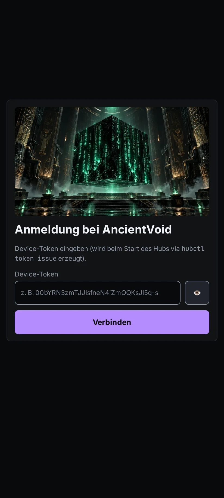
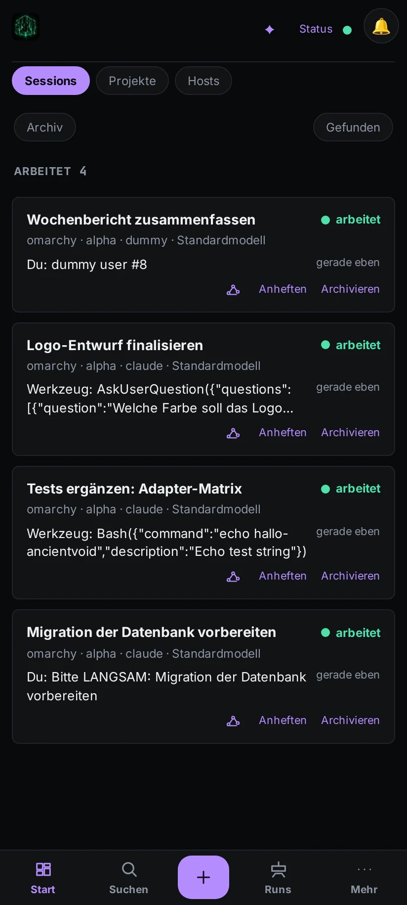

# AncientVoid

**AncientVoid** ist ein local-first, vendor-neutrales Command Center: alle
Coding-Agenten auf allen eigenen Rechnern vom Handy aus überwachen, steuern
und auditieren — über Tailscale, ohne öffentlichen Port, ohne Cloud.

> Basis: PRD „AncientVoid“ v1.0 (12.09.2026) — siehe [`epics/`](./epics/).
> Setup in einem Befehl: [`./setup.sh`](#installation--ein-befehl) (Wizard,
> bindet zuerst den Provider an). Manuelle Route und Detail-Doku:
> [`docs/onboarding.md`](./docs/onboarding.md) (Menschen & Agenten). Alle
> Seiten nach Art geordnet: [`docs/uebersicht.md`](./docs/uebersicht.md).

| Anmeldung | Übersicht (Warteschlange) | Freigabe im Zug | Desktop-Arbeitsfläche |
|---|---|---|---|
|  |  |  |  |

Screenshots entstehen aus einem **Demo-Hub mit synthetischen Stand-ins**
(`scripts/readme-screenshots.mjs`, EPIC-P53) — keine echten Sessions, keine
Secrets; wiederholbar aus dem Repo.

## Ist-Stand (11.11.2026, ehrlich)

Was ein Mensch in der PWA erreichen kann, zählt das
[Funktionsinventar](docs/funktionsinventar.md) (P43-Gate: 63 globale, 72
Session- und 16 PC-Funktionen, je mit E2E-Nachweis). Grobes Bild:

**Fertig und belegt** — Hub-Kern (P0–P4.5: Sessions, EventStore, Worker,
Auth, PWA), Fernsteuerung P5–P9 (Session-Übergabe PC↔Handy, Multi-Host-Flotte,
Harness-Parität inkl. Freigaben/Rückfragen/Anhänge, mobiler Arbeitsplatz,
Aufträge in Worten), Adapter-Flotte (claude, codex, opencode, copilot, pi,
hermes, ACP-Harnesses, Beobachter cursor-clip/claude-clip — Status je Adapter
in der [Matrix](#adapter-status-matrix) unten), Session-Steuerung P15
(Modus/Modell/Pause/Queue), Laufzeit-Robustheit P17 (Resume, K7),
Desktop-Workspace P18 (Kacheln bis 2×2), Loops P19, Slash-Commands P25,
unterbrochene Sessions P27 (interrupted + Weitermachen/Archivieren),
CI-Runner P28, Worktree-Workspace P29, Oberfläche P34/P35 (eigene Fenster,
Harness-Parität Fortsetzen), Diff-Review P36, Session-Arbeitsort P38,
Browser-Arbeitsplatz P39, Zugang P45 („No-go" — Tailnet bleibt).

**Gebaut, Abnahme offen** — Factory-Integration P26 (Code fertig, echte
Factory-Lauf-Abnahme `not_run`), Loops P19 (Handy-Abnahme), P34/P35
(Live-Abnahme AC-P34-13/AC-P35-7, gebündelt im Endabnahme-Block),
Session-Discovery P22/P24 (Live-Abnahme), Automationen P41 (teilweise,
Exit offen), Projekt-Explorer/Dateiansicht P46 (in Umsetzung, Pixel-/
Geräte-Abnahme offen). Details je Epic in [`epics/README.md`](epics/README.md).

**Nicht umgesetzt** — Echtzeit-Sprache P10 (STT-Endpunkte sind
konfigurierbar; Streaming-STT-Pipeline und gemessene Laya-Entscheidung
offen), Desktop-Companion P11, Android-Shell P32 (vertagt), Plugin-/
Provider-Katalog P30/P31 (Planungsentwürfe), englische Doku P33 (vertagt).
Der Audit-Stand von 2026-09-21 ist Geschichte; die Planungskette lebt in
[`epics/README.md`](epics/README.md).

## Roadmap (Auszug)

Aktuelle Kette (je Epic Status, Abhängigkeiten und Umfang in
[`epics/README.md`](epics/README.md)):

- **P43 — UX Next Level** (in Umsetzung): Start als Warteschlange, Session in
  Zügen, Zustands- und Bewegungssprache; danach **P43.5** (Presets/Layouts),
  **P44** (UI-Plugins).
- **P47 → P48 → P49** (Auftrag 10.11.): Übersicht Projekte/Hosts, Repo-Graph
  als pulsierendes Netz, Knowledge-Vault-Notizen.
- **Quer:** **P50** Zoom-robuste Flächen (BUG-0113 offen), **P51**
  Vault-Erreichbarkeit & Tastatur-first, **P52** Repo-Galaxie.
- **Planungsentwürfe (Umsetzung gesperrt):** P30 Adapter-/Sink-Plugins,
  P31 Provider-Katalog, P37 GitLab-Kontext, P40 Hermes-Orchestrierung,
  P42 Android-Testgeräte.

Unterbrochene Sessions: [Gründe, Fortsetzen und Archivieren](docs/interrupted-sessions.md) (P27).

## Installation — ein Befehl

```bash
./setup.sh          # Wizard: Node-Check → ersten Provider anbinden →
                    # npm install → PWA bauen → Device-Token → Hub starten
```

Der Wizard ist idempotent (erneut ausführen ist sicher) und failt laut mit
Exit-Code, wenn eine Voraussetzung fehlt. Erkennt installierte Harness-CLIs
(`claude`, `codex`, `opencode`, `copilot`, `pi`, `hermes`, `dsh`) und trägt
den gewählten Provider ohne eigenen Code ein; OpenAI-kompatible Endpunkte
(llama.cpp, LM Studio, Ollama, vLLM) laufen über die Beispiel-Vorlage;
`dummy` läuft immer. Flags: `--yes`, `--adapter=<id>`, `--port=<n>` (wenn
7373 belegt ist), `--device-label=<name>`, `--voidwarden` (Tokens für
VoidWarden, s. unten), `--no-pwa`, `--no-start`. Hilfe bei Problemen:
Skill `setup-wizard` (Exit-Code-Diagnose) bzw.
[`docs/onboarding.md`](docs/onboarding.md).

**Manuell** (Agenten/CI, entspricht dem Wizard):

```bash
node --version          # 22.18+, 24 oder 26+; entwickelt unter Node 26
npm install
cp apps/hub/hub.config.example.json hub.config.json   # Adapter eintragen
npm -w @ancientvoid/pwa run build
node apps/hub/src/main.ts            # lauscht auf 127.0.0.1:7373

node apps/hubctl/src/cli.ts token issue "pixel-9" --db data/hub.db   # einmalig sichtbar
ANCIENTVOID_TOKEN=<token> node apps/hubctl/src/cli.ts sessions

scripts/setup-tailscale-serve.sh     # Fürs Handy: kein öffentlicher Port!
```

Betrieb, Updates und Rückkehr: [Installations-Runbook](docs/operations-runbook.md).
Verschlüsselte Sicherungen: [Backup/Restore-Runbook](docs/backup-restore.md).
CI-Runner, Ausfallpfad: [CI-Runbook](docs/ci-runbook.md).

## Modularität — das Kernversprechen

Alles ist über Verträge (Contracts) gesteckt, nichts ist im Hub hartverdrahtet:

| Baustein | Package | Erweiterbar durch |
|---|---|---|
| Verträge (Events, Adapter, Worker, WS-Protokoll) | `@ancientvoid/contracts` | — (Stabilitätsgarantie) |
| Hub-Kern (EventStore, Sessions, Registry, DB) | `@ancientvoid/core` | interne Erweiterung via ADR |
| Worker-Runner (tmux / child_process) | `@ancientvoid/workers` | eigene Runner (WSL, remote, …) |
| **Adapter** (Provider, Coding-Tools, lokale Modelle) | `@ancientvoid/adapter-*` | **eigene Endpunkte — s. unten** |
| Adapter-Testkit (Contract-Tests) | `@ancientvoid/adapter-testkit` | — |
| Daemon (REST/WS, Auth, PWA-Serving) | `@ancientvoid/server` | — |
| CLI-Referenzclient | `@ancientvoid/hubctl` | — |
| PWA (dark-first, offline-tolerant) | `@ancientvoid/pwa` | — |
| MCP-Gateway-Sidecar (T4.6, default **aus**) | `@ancientvoid/gateway-mcp` | eigene Operationen — s. [dessen README](apps/gateway-mcp/README.md) |

### Eigene Endpunkte anbinden (der normale Weg, kein Fork nötig)

Ein Adapter ist ein Modul mit `createAdapter(config)` — als lokale Datei ODER
npm-Paket. In `hub.config.json` eintragen, fertig:

```json
{
  "adapters": [
    { "id": "my-provider", "module": "./adapters/my-provider/adapter.ts" },
    { "id": "local-llm", "module": "./examples/adapters/openai-compat/adapter.ts",
      "config": { "baseUrl": "http://127.0.0.1:8080/v1", "model": "qwen2.5-coder" } }
  ]
}
```

Vorlage: [`examples/adapters/openai-compat/`](./examples/adapters/openai-compat/) —
funktioniert mit jedem OpenAI-kompatiblen Endpunkt (llama.cpp, LM Studio,
Ollama, vLLM). Anleitung: [`CONTRIBUTING.md`](./CONTRIBUTING.md) und
[`docs/adapters.md`](./docs/adapters.md). ACP-fähige Harnesses brauchen
**keinen eigenen Adapter** — Preset genügt (`docs/adapters.md` §ACP).

### Adapter-Status-Matrix

Welche Funktion jeder Harness wirklich hat (Folgeprompt, Anhalten, Tool-Freigabe, Rückfragen, Modellwahl, Anhänge): [`docs/harness-matrix.md`](docs/harness-matrix.md) (ADR-0018).

| Adapter | Typ | Reasoning | Tools | Cost | Steer | Kontingent | Status | Phase | Resume (ADR-0036) |
|---|---|---|---|---|---|---|---|---|---|
| `dummy` | synthetisch | ✓ | ✓ | — | ✓ | — | proven | P0 | — |
| `claude` | CLI (stream-json) | ✓ | ✓ | ✓ | ✓ | ✓ | proven | P1 | `claude --resume <id>` |
| `codex` | CLI (`app-server` JSON-RPC, früher `exec`) | ✓ | ✓ | ~ | ✓ | ✓ | proven | P1 | `codex resume <id>` |
| `opencode` | CLI (`--format json`) | ✓ | ✓ | ✓ | ✓ | — | proven | P3 | `opencode --session <id>` |
| `copilot` | CLI (`--output-format json`) | — | ✓ | — | ✓ | — | proven (echte, authentifizierte GitHub-Copilot-CLI 1.0.86 auf dieser Maschine, echte Live-Captures inkl. Tool-Erfolg/-Fehler) | P3 | — |
| `pi` | CLI (`pi -p`, Events+Plaintext) | ✓ | ✓ | — | ✓ | — | proven (pi -p headless live auf omarchy, MR !200; BUG-0066) | P16 | — |
| `swarm` | custom-rag Coding-Swarm REST | ✓ | ✓ | ✓ | ✓ | ? | geplant (Spec real, keine Live-Instanz) | P3 | — |
| ~~`zai`~~ | — | — | — | — | — | — | **entfällt** — real läuft über `opencode` (Provider `zai-coding-plan`) | P3 |
| `local-llm` | OpenAI-kompatibel | ✓ | — | — | ✓ | — | Vorlage bereit (keine lokale Instanz zum Prüfen) | P3 | — |
| `deepseek` | OpenAI-kompatibel (`api.deepseek.com`) | ✓ | — | — | ✓ | — | Vorlage bereit (kein API-Key zum Prüfen) | P3 | — |
| `aider` | CLI (`--message`, Plaintext) | — | ✓ | — | ✓ | — | strukturell gebaut, unproven (kein API-Key/kein realer LLM-Turn hier möglich) | P3 | — |
| `hermes` | CLI (`chat -q --yolo -Q --pass-session-id`, Plaintext) | — | ✓ | — | ✓ | — | built + smoke (echte hermes-Binary auf Zeratul, Session-ID/Resume live verifiziert 03.10.2026) | P13 | `hermes --resume <id>` |
| `cursor-clip` | state.vscdb (read-only) | ✓ | ✓ | — | **nein** | — | proven (echte, live laufende Cursor-Installation auf dieser Maschine, echte SQLite-Reads gegen ihre aktive WAL-Datenbank) — may-break by design (K9) | P3 | — |
| `claude-clip` | Claude-Code-Transcript JSONL (read-only) | ✓ | ✓ | — | **nein** | — | proven (echtes Linux-Transcript-Format, synthetische Datenschutz-Fixtures und Live-Tailing gegen echte Dateien) — may-break by design (K9); beobachtet, übernimmt oder steuert keine externe Session | P3 | — |

Kontingent (`capabilities().usage`, [ADR-0004](docs/adr/0004-account-level-usage-quota.md)):
✓ = liefert real ein Account-Level-Quota-Fenster, — = verifiziert kein
Quota-Signal in der CLI, `?` = noch nicht gebaut/geprüft. Nie geraten (P1.5s
„unbekannt statt geraten"-Regel).

(Ehrlichkeitsklausel: Status wird erst nach bestandenen Contract-Tests auf „proven" gesetzt.)
Die Spalten Reasoning/Tools/Cost/Steer/Kontingent sind gegen jedes Adapters
echten `capabilities()`-Rückgabewert automatisiert geprüft (T3.11):
`npm run check:adapter-matrix` ([`scripts/check-adapter-matrix.mjs`](scripts/check-adapter-matrix.mjs)).
Status/Phase bleiben bewusst manuell — das sind Belege (Tests, Messläufe),
kein reiner Funktionsaufruf.

## Zusammenspiel mit VoidWarden

**VoidWarden** ist das physische Gesicht von AncientVoid: der Pixel-Art-Companion
**Nyx** (ESP32-Board als Statusanzeige) und ein **Web-Kiosk** (PWA), der auf
einem alten Smartphone/Tablet liegt — mit Touch-Freigaben und Sprachausgabe.
VoidWarden liest den Hub ausschließlich über dessen HTTP-API mit einem
eigenen `agent:`-Token (read-only) und entscheidet Freigaben nur mit einem
`display:`-Token (Least Privilege, nie ein menschliches Geräte-Token):

```
                    ┌─ PWA (Handy/PC, Geräte-Token)
AncientVoid-Hub ────┼── HTTP ──▶ VoidWarden-Companion ──WS──▶ Web-Kiosk (altes Handy/Tablet,
 (REST/WS, SQLite)  │                              │           Touch-Freigabe + Stimme)
                    │                              └─NDJSON/USB-Serial─▶ ESP32 (Nyx, Status)
                    └─ hubctl / MCP-Gateway (optional)
```

Gemeinsame Installations-Kaskade (beide Repos, je ein Befehl):

1. **AncientVoid**: `./setup.sh` — Hub + erster Provider + Device-Token.
   Für VoidWarden zusätzlich: `./setup.sh --voidwarden` (stellt
   `agent:voidwarden`- und `display:web-1`-Token aus, einmalig sichtbar;
   `agent:` liest nur, `display:` liest und entscheidet write-Freigaben).
   Ein zweiter Lauf stellt keine weiteren aus — verlorene Tokens per
   `hubctl token revoke` + `token issue` bewusst neu. Optionsfragen am Display
   beantworten (ADR-0066) gibt es nur mit `token issue web-1 --display --answer-questions`.
2. **VoidWarden** (Sibling-Checkout): `./setup.sh` — prüft den Hub, richtet
   Companion und Web-Kiosk ein, druckt die Kiosk-URL. Das Board (Flashen,
   Serial) ist optional — [`voidwarden`](../voidwarden) ·
   [VoidWarden P14](../voidwarden/epics/EPIC-P14-projektdoku-setup-wizard.md)
   (Schwester-Epic von P53).

Keine Laufzeitabhängigkeit zwischen den Repos außer HTTP-API und
`@ancientvoid/contracts` — VoidWarden funktioniert auch ohne Hub weiter
(sichtbar offline, s. dessen Ausfallmodell).

## Messlatten (Auszug, PRD §9)

| ID | Metrik | P0-Umsetzung |
|---|---|---|
| K5 | Event-Payload ≤ 4 KB, Rest in Blobs | EventStore-Kappung + `blob_ref`, Property-getestet |
| K7 | kill -9 → 100 % State-Restore < 3 s | JSONL-Replay + Snapshot + `adapter.recover()` |
| K8 | 20 Sessions × 30 ev/s ohne Verlust | `npm run loadtest` (grün: 605 ev/s aggregiert) |
| K10 | PWA offline: letzte Projektion + Zeitstempel | Service Worker mit `X-AncientVoid-Cached-At` |

## Sicherheit (PRD §8)

- Kein öffentlicher Port — Loopback-Bind + `tailscale serve`.
- Device-Token-Auth (SHA-256-Hashes in SQLite), optional Tailnet-Identitätszwang.
- Agenten-Output ist für die PWA **Daten**, niemals Instruktion.
- Freie Shell vom Handy: nein — nur registrierte Adapter-Operationen.

## Lizenz

[PolyForm Noncommercial 1.0.0](LICENSE) — private und nicht-kommerzielle Nutzung erlaubt, kommerzielle Nutzung nicht. Keine OSI-Open-Source-Lizenz (Entscheidung Jan, 2026-11-09, T4.8).
